[Return to Home](../index.html){: .btn} [Strategy Guide](../strategy/index.html){: .btn}

# Vloxx Mechanical Reference
{: .no_toc}

This page contains a detailed reference of the various attacks and mechanics present in the encounter. It is structured into the following sections:
1. [Overview](#overview) - basic description of the fight and its main points.
2. [Structure](#fight-structure) - analysis of fight structure, transitions and difference between phases.
3. [Mechanics](#general-mechanics) - description of all mechanics in the encounter, divided by phase.
4. [Enemies](#enemies) - description of all minor adds and enemies appearing in the encounter.

<b>Table of Contents</b>

1. TOC
{:toc}

## Overview

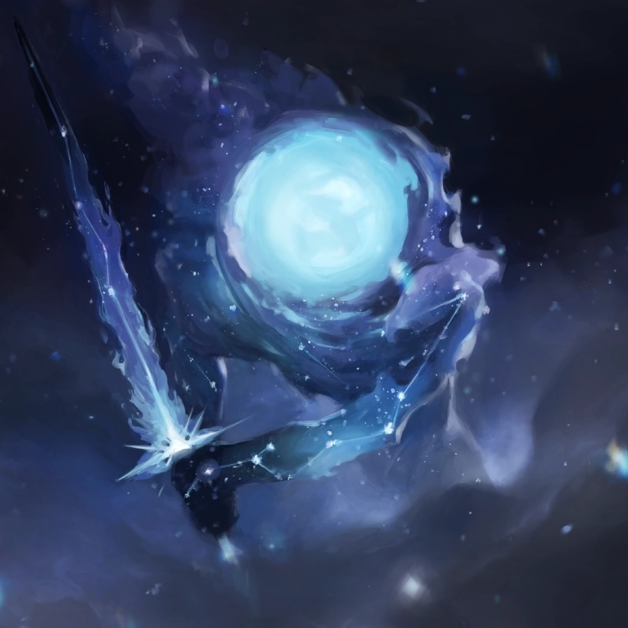

| **Health** |  84'939'840 (CM), 102'777'208 (LM) |
| **Defiance Bar** | 6000 |
| **Armor** | 2597 (standard) |
| **Hitbox** | 180 (medium) |
| **Enrage** |  10 minutes, kills everyone on running out. |

Vloxx is a challenging, mobile boss with a wide variety of mechanics and attacks. His combat style focuses around his armaments: *Staff*, *Spear* and *Sword*. Whichever one he is wielding determines the majority of his move-set, which changes based on the phase of the encounter.

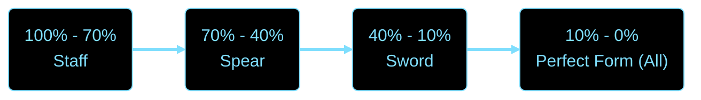
{: .center}

Vloxx's behaviour is based on a priority-cooldown system:
- All active mechanics have their own *cooldown* and *priority*.
- The boss will always cast the highest priority skill that is off-cooldown.

While this is similar in concept to bosses such as [Greer](https://silverhalf.github.io/mount-balrior/greer/overview.html) and [Ura](https://silverhalf.github.io/mount-balrior/ura/overview.html), in practice Vloxx's relatively short cooldowns and absence of skill interruptions means the boss will usually present the same order of mechanics consistently for each phase.

Exceptions to this standard order occur in high DPS situations, where skills do not have the time to come off-cooldown after split phases, and in situations where the boss cannot properly select targets.

Vloxx is fully mobile and makes use of both skills and normal movement to reposition and hit targets with his mechanics.

---

####  Empowered and  Ascension

These are diametrically opposite effects that have a huge impact on the encounter.

 [Empowered], similar to other bosses such as [Cerus](https://silverhalf.github.io/temple-of-febe/) and [Greer](https://silverhalf.github.io/mount-balrior/greer/overview.html), increases Vloxx's outgoing damage, and is gained whenever players fail mechanics. However, unlike these encounters, it also *reduces* incoming damage, making it vastly more dangerous. Furthermore, Vloxx will passively gain this effect from any living [Champion Weapons](#weapons), additionally gaining 10  stacks whenever the boss transitions out of a split phase.

When this mechanic is mismanaged, the group will start dealing increasingly less damage as the fight progresses, as mechanics in the later phases will become dangerously difficult to out-heal.

The only way to curb this effect is through its opposing mechanic,  [Ascension]. This is a buff applied to players, stacking up to 10. Losing any amount of  [Ascension] results in the boss gaining the same amount of  [Empowered], but the opposite is also true: gaining  [Ascension] is the only way of reducing  [Empowered].

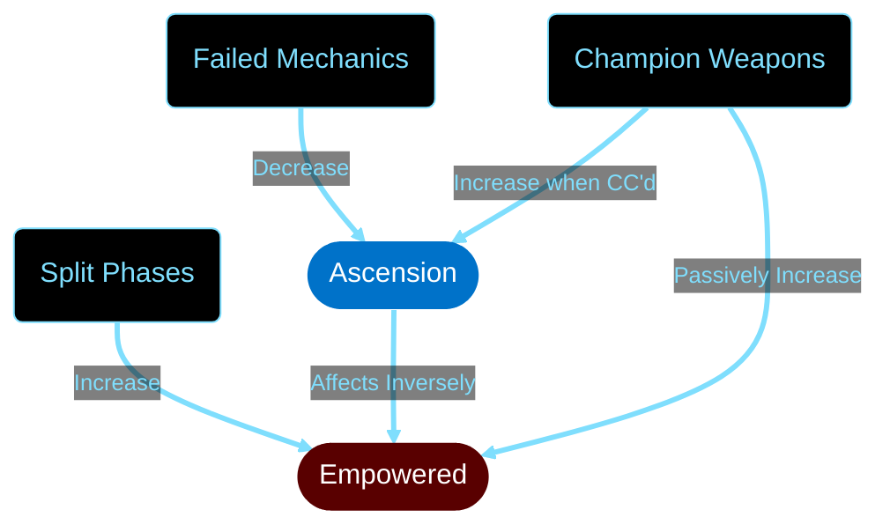
{: .center}

The only source of  [Ascension] is breaking the  [Defiance Bar] of any [Champion Weapons](#weapons) once they reach 25% of their maximum HP. Therefore, the encounter  mandates a large amount of cleave and careful positioning to both reduce the time that weapons spend alive and provide a steady source of  [Ascension] to offset the boss' passive  [Empowered] gains.

---

#### Fixation

Much of Vloxx's skill targeting is based on the fixation mechanic. Vloxx will select a  [Fixated] player at the beginning of the fight, who then becomes the focus of most of his mechanics. Vloxx will then periodically swap his target to another random player.

The random nature of this mechanics means that players have to be ready to improvise and reposition rapidly in response to changes, especially when dealing with [Judgement of Eternity] and [Excision Extremis], which can both potentially end a run if mismanaged.

---

#### Table of Mechanics

A brief description of the primary attacks performed by Vloxx in the encounter. Click on a mechanic to view additional information.

|**Mechanic**|**Phase**|**Common Name**|**Brief Description**|
| [Judgement of Eternity] | All | Greens | Three greens requiring three people each. |
| [Probability Distribution] | All | Pools, Spreads | Three large AoEs that leave lingering pools. |
| [Annihilating Orb] |  | Orb, Teleport | Launches a massive orb in a line, then teleports to its final location. |
| [Ascension's Sacrifice] |  | Chains | Targets players with chains that require a friend. |
| [Eternal Reflection] |  | Cone, Barrage | Launches a barrage of exploding projectiles in a cone. |
| [Surrounding Curse] |   | Small AoEs | Summons a rain of projectiles on the group. |
| [Cosmic Charge] |  | Charge | Charges in a line, leaving damaging pools on its trail. |
| [Raging Storm] |   | Spears | Launches a series of spears that  [Knockback] and leave lingering pools. |
| [Thousand Strikes] |  | Cone | A barrage of spear thrusts in a cone. |
| [Worldpiercer] |  | Walls, Pizza | Six walls divide the arena into six slices. |
| [Division Eternal] |  | Rectangle | Large rectangular damaging AoE. |
| [Echoing Blade] |  | Circle, Swords | Circular attack that launches rotating sword projectiles. |
| [Excision Extremis] |   | Geometry, Bladestorm | Large amount of overlapping semicircular AoE damage and boonstrip. |
| [Slice Through Reality] |  | Teleport, Suction | Teleport skill that leaves a rift that sucks in players. |

## Fight Structure

The battle against Vloxx is divided into three main phases, three split phases and a final phase, following the same structure as recent releases such as the [Temple of Febe](https://silverhalf.github.io/temple-of-febe) and [Mount Balrior](https://silverhalf.github.io/mount-balrior) encounters.

---

### 100% - 70% - Staff Phase

#### Typical Opening
{: .no_toc}

{: .center}

This phase is characterized by a large amount of projectiles: reflecting or blocking these can be potentially dangerous since some will bounce off, resulting in several potentially dangerous AoEs. Vloxx's staff is modeled after [Ancora Pax](https://wiki.guildwars2.com/wiki/Ancora_Pax).

*Weapon Skills:* [Annihilating Orb], [Ascension's Sacrifice], [Eternal Reflection], [Surrounding Curse]

<b>Full Timeline</b>

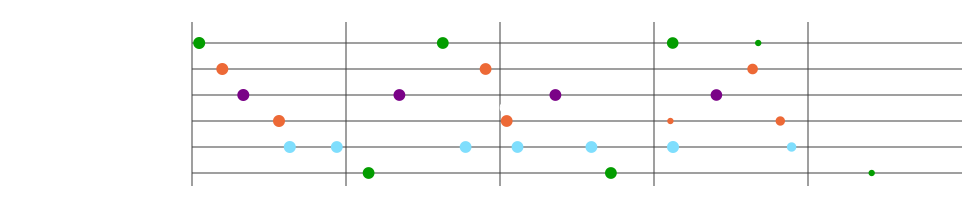

Graphic adapted from [elisethechemist's Vloxx Field Guide](https://elisethechemist.com/INT/Vloxx_CM_Field_Guide_dark.html). Each dot is a cast, placed at its median offset from the start of the phase. Bigger, darker dots tend to happen in more pulls.

---

### 70% - 40% - Spear Phase

#### Typical Opening
{: .no_toc}

{: .center}

This phase is mostly characterized by [Worldpiercer] heavily limiting squad movement while [Raging Storm] requires either permanent projectile block or constant repositioning. Vloxx's spear is modeled after [Ancora Bellum](https://wiki.guildwars2.com/wiki/Ancora_Bellum).

*Weapon Skills:* [Cosmic Charge], [Raging Storm], [Thousand Strikes], [Worldpiercer]

<b>Full Timeline</b>

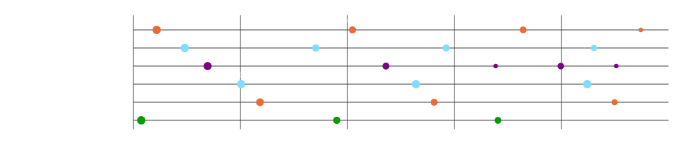

Graphic adapted from [elisethechemist's Vloxx Field Guide](https://elisethechemist.com/INT/Vloxx_CM_Field_Guide_dark.html). Each dot is a cast, placed at its median offset from the start of the phase. Bigger, darker dots tend to happen in more pulls.

---

### 40% - 10% - Sword Phase

#### Typical Opening
{: .no_toc}

{: .center}

This phase is characterized by a large amount of AoE Damage, especially from [Echoing Blade] and [Excision Extremis]. This requires a lot of attention from the group to either out-heal or avoid most of the danger. Vloxx's sword is modeled after [Wages of Stars](https://wiki.guildwars2.com/wiki/Wages_of_Stars).

*Weapon Skills:* [Division Eternal], [Echoing Blade], [Excision Extremis], [Slice Through Reality]

<b>Full Timeline</b>

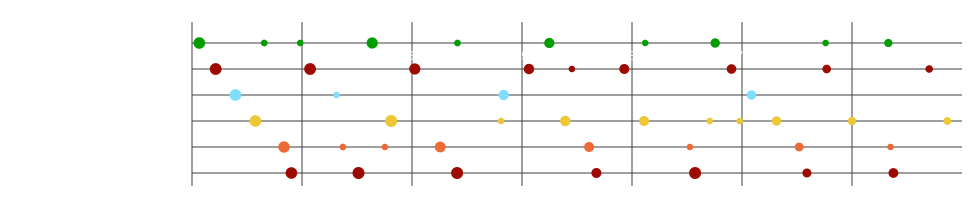

Graphic adapted from [elisethechemist's Vloxx Field Guide](https://elisethechemist.com/INT/Vloxx_CM_Field_Guide_dark.html). Each dot is a cast, placed at its median offset from the start of the phase. Bigger, darker dots tend to happen in more pulls.

---

### 10% - 0% - Perfect Form

At the beginning of this phase, Vloxx will transition into his final form. He will then cast [Threshold of Eternity], which kills all players 2 minutes after the beginning of the phase. During this cast, Vloxx will constantly cycle through a [subset of skills](#attacks-included) from all previous phases of the encounter.

---

### Split Phases

Each split phase starts with Vloxx teleporting to the center of the arena and gaining  [Defensive Inspiration](), making them  [Invulnerable]. An enemy champion will them spawn, along with two elites. The type of enemy depends on the phase:
- 70% - [Cosmic Piercer](#split-phase-enemies) champion and elites.
- 40% - [Cosmic Bulwark](#split-phase-enemies) champion, [Cosmic Piercer](#split-phase-enemies) elites.
- 10% - [Cosmic Sunderer](#split-phase-enemies) champion, [Cosmic Piercer](#split-phase-enemies) and [Cosmic Bulwark](#split-phase-enemies) elites.

{: .legendary}
All enemies summoned in split phases will be Champion versions instead.

Killing all three enemies unlocks Vloxx's  [Defiance Bar], allowing the squad to break it and continue into the following phase.

## General Mechanics

These mechanics are present for the entirety of the fight independent of the phase.

|**Mechanic**|**Common Name**|**Brief Description**|
|  [Empowered] | Stacks | Buff applied to Vloxx on failed mechanics. |
|  [Ascension] | Stacks | Buff applied to players to counteract  [Empowered]. |
|  [Fixate] | Tank | Randomly selects a player to become the target for Vloxx's attacks. |
| [Judgement of Eternity] | Greens | Three greens requiring three people each. |
| [Probability Distribution] | Pools | Three large AoEs that leave lingering pools. |

---

###  Empowered

 [Empowered] is an effect gained by Vloxx from several sources over the course of the encounter. Each stack grants him 5% increased outgoing damage and 1% reduced incoming damage, stacking additively. Additionally, Vloxx starts gaining boons at certain stack thresholds:
- At 5  stacks, he periodically gains  [Might].
- At 15  stacks, he periodically gains 25  [Might].
- At 50  stacks, he periodically gains  [Resolution].
- At 75  stacks, he periodically gains  [Protection].

Vloxx can gain  [Empowered] in three ways:
- [Champion Weapons](#weapons) will grant him one  stack 24 seconds after spawning and one additional  stack at 20 second intervals following.
- [Visions of Eternity] will grant him 10  stacks when he either completes the cast or his  [Defiance Bar] is broken.
- Whenever a player loses one or more stacks of  [Ascension], Vloxx will gain an equivalent number of  [Empowered].

{: .note}
This counts dead players as well, since they "lose" 10  stacks on dying. Vloxx will therefore gain 10  [Empowered] for each dead player.

Additionally, whenever a player gains a stack of  [Ascension], Vloxx will *lose* a stack of  [Empowered].

---

###  Ascension

 [Ascension] is a player buff that is diametrically opposed to  [Empowered]. All players will begin the encounter with 10  stacks, and will immediately die if they ever reach zero.

Players *lose*  stacks whenever they fail certain mechanics:
- [Judgement of Eternity] - every player inside a green when it fails loses 3  stacks.
- [Ascension's Sacrifice] - if a chain fails, the chained player loses a  stack.
- [Slice Through Reality] - every player that is dragged into the teleport area after it spawns loses a  stack.

Whenever a player loses  stacks, Vloxx will gain the same number of  [Empowered].

Players will *gain*  stacks whenever they pick up *orbs*. Three of these drop from [Champion Weapons](#weapons) whenever their  [Defiance Bar] is broken.

---

###  Fixate

This effect is applied to a random player in Vloxx's range. This player will hear an audio cue and gain an  icon over their head showing the effect. They will then become the primary target for most of Vloxx's skills.

The effect lasts for 60 seconds, and is re-assigned 10 seconds after running out.

---

### Judgement of Eternity

<video class='bordered center' width="100%" controls>
<source src='../videos/judgement-of-eternity.mp4' type='video/mp4'>
</video>

|*Common Name*| Greens |
|*Used By*| Vloxx |
|*Used in Phases*| All |
|*Cooldown*| 40 seconds |

Targets the  [Fixated] player and the two closest non-fixated players with a green, requiring three people inside. Failing to solve a green deals moderate damage, applies  [Burning],  [Chilled] and  [Float], and removes three stacks of  [Ascension] from all players in its area.

Players standing in multiple greens will go  [Downstate]. This cannot be prevented by damage immunity or invulnerability effects such as  [We Will Never Yield!] or  [Tale of the August Queen], unlike other similar mechanics. Additionally, they are not counted as being inside either green, possibly leading them to fail.

Greens have a maximum range of 3000 units. The number of greens in this mechanic depends on the number of living players: with less players alive, fewer greens will spawn so that the mechanic is always solvable.

---

#### Strategy (Anchors)
{: .no_toc}

The squad is divided into three groups of three people, usually called *left*, *mid* and *right*. Each group will have an *anchor*, representing the location where the group will stack inside a green. The *anchors* for the side groups act as *green baiters*, and attempt to stand  close to the boss to get targeted by a green. The tenth person is usually called the *joker* or the *float*. 

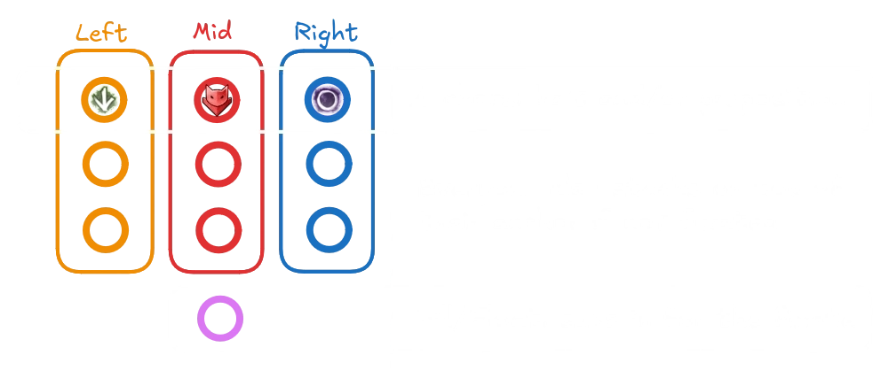

When the  [Fixate] is selected from the middle group, all players can stack on top of their anchor to solve the mechanic with no additional adjustments.

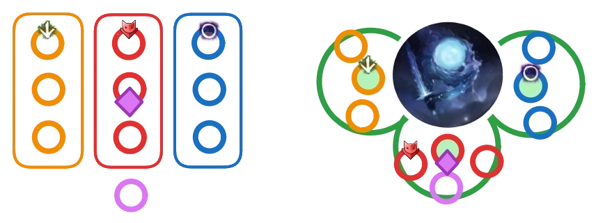

If the  [Fixate] is selected from a side group, they should move to the middle and call for a backup (usually "backup left/right/arrow/circle"). The *float* can then move to even out the numbers. 

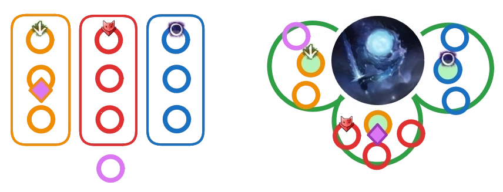

{: .note}
Whenever a new player is fixated, they should call their group to ensure the *float* already knows where to go.

If the  [Fixate] is also an *anchor*, the *float* should also bait a green in their stead. Anchors should therefore communicate when they specifically are fixated (usually "left/right/arrow/circle anchor fixated").

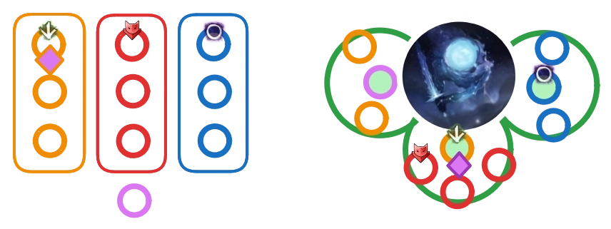

---

#### Strategy (Subgroups)
{: .no_toc}

The squad is divided into a *melee* group and a *ranged* group. One player from the ranged sub will act as the *joker* or *float*.

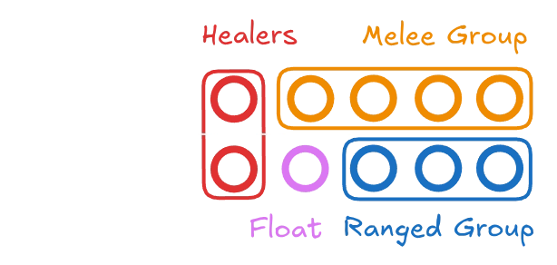

The mechanic is solved by having the  [Fixate] stack with the healers, while all four player from the *melee* group try to bait a green. This should result in two of them getting targeted: one of them will then move over to the ranged group. This way, all three groups will have a green.

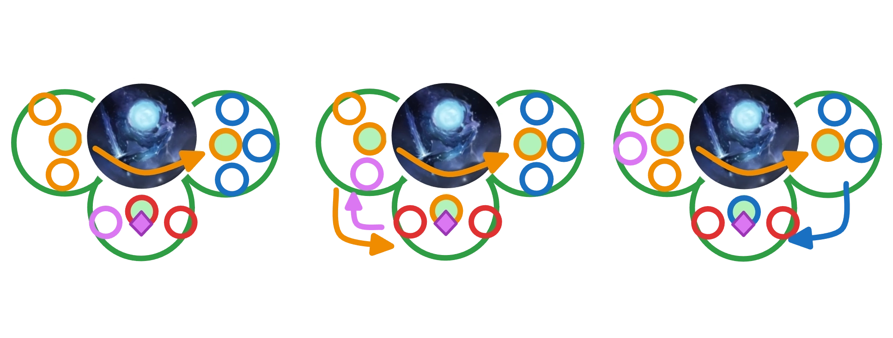

Whenever the  [Fixate] is one of the healers, the *float* should move to their group. Otherwise, they can play in the melee group. If a person in the *ranged* group accidentally baits a green, they can move to that group to backup if necessary.

---

### Probability Distribution

<video class='bordered center' width="100%" controls>
<source src='../videos/probability-distribution.mp4' type='video/mp4'>
</video>

|*Common Name*| Puddles, Spreads |
|*Used By*| Vloxx |
|*Used in Phases*| All |
|*Cooldown*| 30 seconds |

Targets the  [Fixate] and two additional random players with large tracking AoEs. After following their targets for five seconds, they will become stationary and explode three second later, dealing moderate damage and inflicting  [Knockback] and  [Poison] to any players in the area and turning into stationary pools.

Pools two pulse damage and inflict  [Crippled], and last for two minutes or until the next phase change.

#### Strategy
{: .no_toc}
This attack has no indicator except for the AoE, so it is relatively common for players not to realize when they are targeted. The common solution is to "wiggle" when the AoEs appear, which makes it easier to see who is targeted (similar to what occurs on KO CM).

## Staff Attacks

These attacks can be used by Vloxx during the first phase or the final phase, or by the [Champion Staff].

|**Mechanic**|**Common Name**|**Brief Description**|
| [Annihilating Orb] | Orb, Teleport | Launches a massive orb in a line, then teleports to its final location. |
| [Ascension's Sacrifice] | Chains | Targets players with chains that require a friend. |
| [Eternal Reflection] | Cone, Barrage | Launches a barrage of exploding projectiles in a cone. |
| [Surrounding Curse] | Small AoEs | Summons a rain of projectiles on the group. |

---

### Annihilating Orb

<video class='bordered center' width="100%" controls>
<source src='../videos/annihilating-orb.mp4' type='video/mp4'>
</video>

|*Common Name*| Orb, Port |
|*Used By*| Vloxx |
|*Used in Phases*| [Phase 1] |
|*Cooldown*| 30 seconds |

Launches a massive orb towards the  [Fixated] player, indicating the direction with a large arrow. The orb inflicts  [Slow],  [Burning] and  [Knockback] to players in its area. Once it reaches its maximum range of 1500 units, Vloxx teleports to it, unleashing a shockwave that deals damage and inflicts  [Knockback].

After teleporting, Vloxx will maintain an aura for a few seconds that continues to  [Knockback] and  [Slow] players.

{: .warning}
There is a common bug where the shockwave from this attack is invisible. Always try to dodge or jump, even if you cannot see it.

#### Strategy
{: .no_toc}
Supports should provide  [Aegis] or  [Stability] for the initial  [Knockback] and ideally also for the secondary shockwave.  [Superspeed] is also extremely useful to increase damage uptime and improve positioning.

---

### Ascension's Sacrifice

<video class='bordered center' width="100%" controls>
<source src='../videos/ascensions-sacrifice.mp4' type='video/mp4'>
</video>

|*Common Name*| Stunbreak, Greens, Chains |
|*Used By*| Vloxx |
|*Used in Phases*| [Phase 1] |
|*Cooldown*| est. 45 seconds |

Three players, including the  [Fixate], will get targeted by chains. These  [Float] and push away the chained player, summoning a small green below them that requires two players to solve. Failing to solve a green will  [Float] the chained player a second time and remove a stack of  [Ascension] from them.

Players standing in multiple greens will go  [Downstate]. This cannot be prevented by damage immunity or invulnerability effects such as  [We Will Never Yield!] or  [Tale of the August Queen], unlike other similar mechanics.

#### Strategy
{: .no_toc}
To improve damage uptime overall, supports should  [Stunbreak] the chained players out of the initial  [Float]. To improve green solving, a common approach is to try splitting into the same groups that would be used to solve [Judgement of Eternity].

---

### Eternal Reflection

<video class='bordered center' width="100%" controls>
<source src='../videos/eternal-reflection.mp4' type='video/mp4'>
</video>

|*Common Name*| Fan, Cone, "Who is reflecting?!" |
|*Used By*| Vloxx, [Champion Staff] |
|*Used in Phases*| [Phase 1] |
|*Cooldown*| est. 9 seconds |

Launches a barrage of projectiles in a wide cone towards the  [Fixate], dealing moderate damage.

{: .warning}
These projectiles bounce and explode whenever they interact with projectile destruction or reflection effects such as  [Feedback] or  [Corrosive Poison Cloud], dealing heavy damage in proximity of the effect.

---

### Surrounding Curse

<video class='bordered center' width="100%" controls>
<source src='../videos/surrounding-curse.mp4' type='video/mp4'>
</video>

|*Common Name*| Rain, Small AoES |
|*Used By*| Vloxx, [Champion Staff] |
|*Used in Phases*| [Phase 1], [Phase 4] |
|*Cooldown*| est. 30 seconds |

Summons a rain of small projectiles on the  [Fixate] that explode, dealing light damage and inflicting  [Torment] and  [Weakness].

{: .note}
While this attack can technically be reflected, it will often overlap with [Eternal Reflection], which makes it dangerous to do so.

#### Strategy
{: .no_toc}
This attack has a very obvious telegraph, meaning players have more than enough time to walk out of the AoEs. Projectile reflection can be used if necessary, but players should be careful in proximity of the [Champion Staff], as it could use [Eternal Reflection] at any point.

## Spear Attacks

These attacks can be used by Vloxx during the second phase or the final phase, or by the [Champion Spear].

|**Mechanic**|**Common Name**|**Brief Description**|
| [Cosmic Charge] | Charge | Charges in a line, leaving damaging pools on its trail. |
| [Raging Storm] | Spears | Launches a barrage of spears that  [Knockback] and leave lingering pools. |
| [Thousand Strikes] | Cone | Launches a barrage of spear thrusts in a cone. |
| [Worldpiercer] | Walls, Lines | Six walls divide the arena into six slices. |

---

### Cosmic Charge

<video class='bordered center' width="100%" controls>
<source src='../videos/cosmic-charge.mp4' type='video/mp4'>
</video>

|*Common Name*| Charge, Dash |
|*Used By*| Vloxx, [Champion Spear] |
|*Used in Phases*| [Phase 2] |
|*Cooldown*| 45 seconds |

Targets the  [Fixate] with a large orange arrow. After a brief pause, charges forward for 1500 units, dealing moderate damage, inflicting  [Knockback] and leaving behind a trail of lingering puddles. These corrupt boons and inflict  [Crippled] and  [Burning].

#### Strategy
{: .no_toc}
This attack often occurs simultaneously with [Judgement of Eternity], making it extremely important to avoid  [Knockback] affecting player positioning.  [Stability] is thus extremely important, as the dash hits multiple times. The trail itself also strips boons, so if players have to stand inside it, the only surefire way to mitigate this mechanic becomes mass  [Invulnerability] with  [Tale of the August Queen].

---

### Raging Storm

<video class='bordered center' width="100%" controls>
<source src='../videos/raging storm.mp4' type='video/mp4'>
</video>

|*Common Name*| Spears, Reflect |
|*Used By*| Vloxx |
|*Used in Phases*| [Phase 2], [Phase 4] |
|*Cooldown*| 36 seconds |

Targets the  [Fixate] with a barrage of 16 spears at 1 second intervals. Each spear explodes in a small AoE on hitting the floor, dealing moderate damage, inflicting  [Knockback] and leaving behind a lingering puddle. This puddle deals moderate damage and strips boons.

Spears are projectiles and thus affected by projectile disruption.

#### Final Phase
{: .no_toc}
In [phase 4], the behaviour of this skill changes slightly. Instead of launching one spear per second, Vloxx will launch eight barrages of three or six spears every three seconds.

{: .legendary}
Spears are no longer affected by projectile disruption during the final phase.

#### Strategy
{: .no_toc}
The most common way to mitigate this mechanic is by defining a rotation of projectile disruption skills to maintain coverage throughout the duration of the mechanic. This commonly involves four people in sequence, each one using skills such as  [Feedback] and  [Corrosive Poison Cloud].

---

### Thousand Strikes

<video class='bordered center' width="100%" controls>
<source src='../videos/thousand-strikes.mp4' type='video/mp4'>
</video>

|*Common Name*| Cone, Thrusts |
|*Used By*| Vloxx, [Champion Spear] |
|*Used in Phases*| [Phase 2] |
|*Cooldown*| est. 8 seconds |

Vloxx attacks with a rapid series of strikes in a cone, dealing heavy damage and inflicting  [Vulnerability].

---

### Worldpiercer

<video class='bordered center' width="100%" controls>
<source src='../videos/worldpiercer.mp4' type='video/mp4'>
</video>

|*Common Name*| Walls, Pizza |
|*Used By*| Vloxx |
|*Used in Phases*| [Phase 2] |
|*Cooldown*| 30 seconds |

Vloxx summons six red arrows in a star, which fire after a delay,  [Downstating] any player caught in one and killing any player caught in two.

The arrows then leave behind narrow walls that inflict  [Knockback] and 10 stacks of  [Burning] on any players that attempt to walk through their area. It is possible to dodge through these, or walk through with  [Stability] while cleansing the conditions.

Walls persist for 10 seconds, and are not removed on phase changes.

#### Strategy
{: .no_toc}
This attack has a very long telegraph, leaving players with a lot of time to position inside one of the "slices" before they're cut off. It's important for the entire squad to be inside the same slice to solve mechanics such as [Raging Storm] and [Judgement of Eternity].

## Sword Attacks

These attacks can be used by Vloxx during the third phase or the final phase, or by the [Champion Sword].

|**Mechanic**|**Common Name**|**Brief Description**|
| [Division Eternal] | Rectangle | Large rectangular damaging AoE. |
| [Echoing Blade] | Circle | Circular attack that launches rotating sword projectiles. |
| [Excision Extremis] | Blades, Storm | Large amount of overlapping semicircular AoE damage and boonstrip. |
| [Slice Through Reality] | Teleport, Suction | Teleport skill that leaves a rift that sucks in players. |

---

### Division Eternal

<video class='bordered center' width="100%" controls>
<source src='../videos/division-eternal.mp4' type='video/mp4'>
</video>

|*Common Name*| Rectangle |
|*Used By*| Vloxx, [Champion Sword] |
|*Used in Phases*| [Phase 3] |
|*Cooldown*| 5 seconds |

Throws a massive sword at the  [Fixate], resulting in a large rectangular AoE that inflicts high damage, strips boons and applies  [Blinded] and  [Confusion].

This skill deals damage multiple times over its length: players that are too far from the boss can get hit multiple times, resulting in increased damage.

#### Strategy
{: .no_toc}
This attack has a very long and recognizable wind-up, giving players a large amount of time to move out of its AoE or dodge. This is especially relevant for the  [Fixate] in [phase 3], who should also try to be close to the boss in order to avoid multi-hits.

---

### Echoing Blade

<video class='bordered center' width="100%" controls>
<source src='../videos/echoing-blade.mp4' type='video/mp4'>
</video>

|*Common Name*| Circle, Red Swords |
|*Used By*| Vloxx |
|*Used in Phases*| [Phase 3] |
|*Cooldown*| 20 seconds |

Circular attack composed of several semicircular AoE slices centered around the boss, combined with red rotating sword projectiles. While each slice deals moderate damage, the cumulative damage from multiple hits can quickly become threatening. Sword projectiles apply moderate damage and inflict  [Torment] and  [Weakness], and can be deleted using standard projectile disruption.

{: .legendary}
Projectiles from this attack ignore projectile disruption.

#### Strategy
{: .no_toc}
Players should try to dodge at least some of the damage from this skill, especially if the boss has a lot of  [Empowered]. Use projectile disruption effects on the squad and on the  [Fixate] to avoid the sword projectiles. When this attack overlaps with [Judgement of Eternity], one projectile disruption effect should be used per green group: sort this out beforehand.

---

### Excision Extremis

<video class='bordered center' width="100%" controls>
<source src='../videos/excision-extremis.mp4' type='video/mp4'>
</video>

|*Common Name*| Geometry, Bladestorm |
|*Used By*| Vloxx, [Champion Sword] |
|*Used in Phases*| [Phase 3], [Phase 4] |
|*Cooldown*| 10 seconds |

Large scale attack consisting of a storm of overlapping semicircular AoEs with a radius of 250 units. These deal moderate damage after a delay, inflicting  [Crippled] and  [Bleeding] and stripping boons with an internal cooldown of 2 seconds. While individual attacks are not dangerous, the cumulative damage from multiple hits can quickly become threatening.

Vloxx will randomly select four targets for this attack (three in [phase 4]), while the [Champion Sword] will always select only one. Each target will then generate four semicircular sword swipes, resulting in 16 attacks in [phase 3], 12 in [phase 4], and 4 from the [Champion Sword].

Pattern Generation Details

The position and orientation of the sword attacks used in [Excision Extremis] depends on the orientation of the caster and the relative position of the caster and the target.

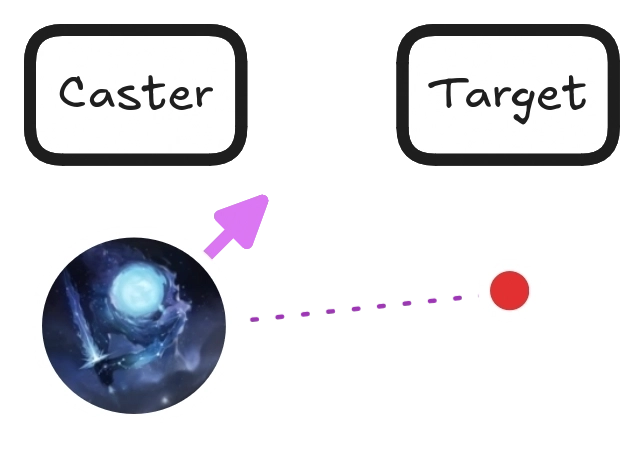

Attacks originate from a circle 400 units in diameter centered on the target. The first attack will always be on the point of this circle closest to both, with successive attacks positioned through a 90 degree rotation clockwise from the target.

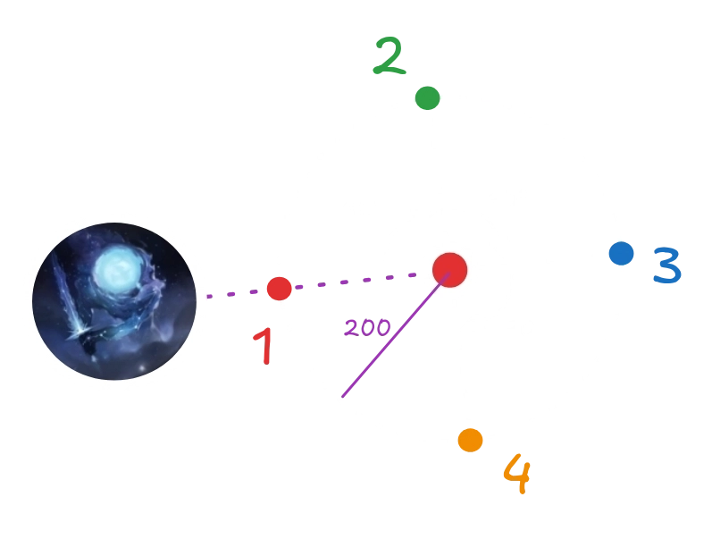
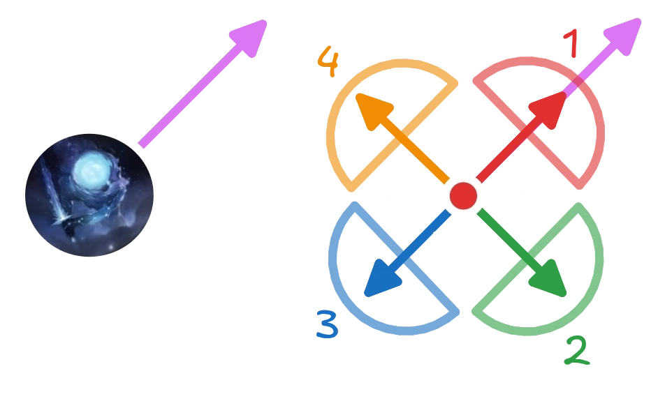

The orientation of the first attack will always match the orientation of the caster. Orientation of successive attacks is obtained through a 90 degree rotation clockwise. Combining the origin and orientation of the sword attacks results in the final pattern.

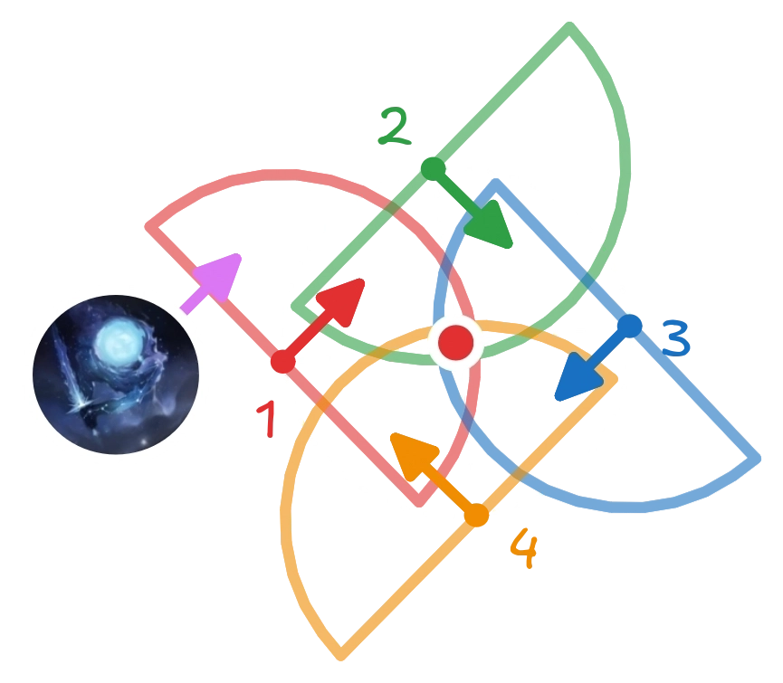

#### Strategy
{: .no_toc}

Having the  [Fixate] position opposite from the stack forces the boss to face away from the main group. This is called *opposition tanking* and results in drastically safer patterns, since when the target is *behind* the caster, all sword AoEs will face *outwards*, reducing overlap and leaving the inside unaffected.

Video: difference between generated patterns when the target is in front of vs. behind the boss. This animation was generated using [Narokath's Excision Simulator](https://narokath.github.io/vloxx-guide/excision-simulator.html).

<video class='bordered center' width="80%" controls>
<source src='../videos/excision-single-target.mp4' type='video/mp4'>
</video>

On the other hand, when the target is *in front* of Vloxx all AoEs will face *inwards*, increasing the overlap on the group. In this case, out-healing all the incoming damage can be very difficult: players should double dodge to avoid as many AoEs as possible, then heal up and re-boon. Alternatively, mass  [Invulnerability] skills such as  [Tale of the August Queen] can be used.

---

### Slice Through Reality

<video class='bordered center' width="100%" controls>
<source src='../videos/slice-through-reality.mp4' type='video/mp4'>
</video>

|*Common Name*| Teleport, Suck |
|*Used By*| Vloxx |
|*Used in Phases*| [Phase 3] |
|*Cooldown*| 60 seconds |

Vloxx slices through space, opening up a rift that transports him to a different location, 1500 units in the direction of the  [Fixate]. Any players inside of Vloxx's hitbox will be transported with him. 

The entrance of the rift sucks in players, while the exit pushes them away. Players sucked into the rift after the initial teleportation will be transported to Vloxx's new location, have three boons corrupted and lose a stack of  [Ascension].

Any player that takes the rift, whether through the initial teleportation or later on, will get afflicted by  [Knockdown].

#### Strategy
{: .no_toc}
Groups will either have everyone enter the rift (common with melee strategies) or no-one (requires a ranged strategy). When taking the rift, it's important to mitigate the  [Knockdown] either by providing  [Stability] before or with a  [Stunbreak] immediately after.

 [Superspeed] is also extremely important to reduce the effect of the suction and pushback effects. This is doubly important for the  [Fixate], as they will have to position correctly immediately after.

## Special Attacks

These mechanics consist of sequences of consecutive attacks that only appear in specific moments of the fight.

---

### Visions of Eternity

This attack is cast upon reaching *70%*, *%40%* and *10%* of Vloxx's maximum HP, triggering the beginning of his split phases. Vloxx will become  [Invulnerable] and start charging up a massive strike. While doing so, he will summon a [Champion Elemental] and three [Elite Elementals], with the composition of enemies depending on the specific split phase.

{: .legendary}
Vloxx will instead summon four [Champion Elementals](#champion-elemental).

He will then start casting large AoEs targeting the group, which slowly fill, dealing moderate damage and applying  [Float] to players caught inside on completion.

This attack can be interrupted by killing all the summoned elementals, which unlocks Vloxx's  [Defiance Bar]. Breaking this bar will stop the attack, grant Vloxx 10  [Empowered], and begin the following phase.

If the attack is allowed to complete, 67 seconds after Vloxx becomes invulnerable, it will instantly defeat all players.

---

### Threshold of Eternity

This attack is used by Vloxx at the beginning of the 10% phase. He begins by becoming  [Invulnerable] while changing to his final form over the course of 15 seconds, upon which he becomes vulnerable once more.

While this transformation is ongoing, he will start casting a combination of attacks from all three phases.

#### Attacks Included
{: .no_toc .center}

|**General Attacks**| [Judgement of Eternity], [Probability Distribution] |
|**Staff Attacks**| [Surrounding Curse] |
|**Spear Attacks**| [Raging Storm] |
|**Sword Attacks**| [Excision Extremis] |

These mechanics rotate continuously until the boss is dead.

This attack will also start a timer which overrides the enrage for the fight, shortening it to two minutes if there was more time available. If this timer runs out, Vloxx will instantly defeat all players.

## Enemies

The Nexus of Eternity encounter is characterized by a large amount of enemy adds that enter the picture at different points in the encounter. These can mostly be divided into two groups: *split phase adds* and *weapon adds*.

---

### Weapons

These are three Champion Weapons, one for each of Vloxx's armaments:

#### Aspect of the Staff
{: .no_toc}
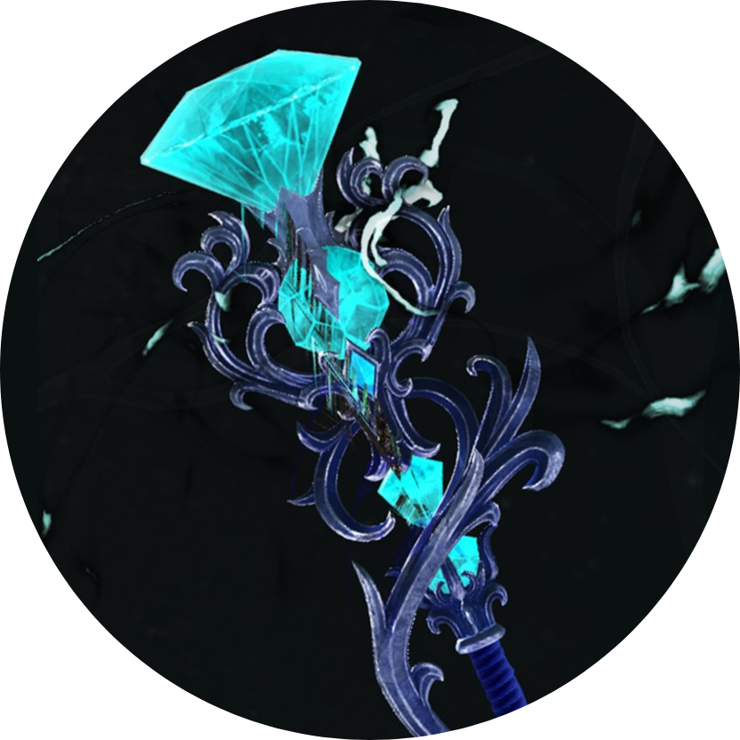
Spawns at the beginning of the fight. Can use the skills: [Eternal Reflection], [Surrounding Curse].

#### Aspect of the Spear
{: .no_toc}
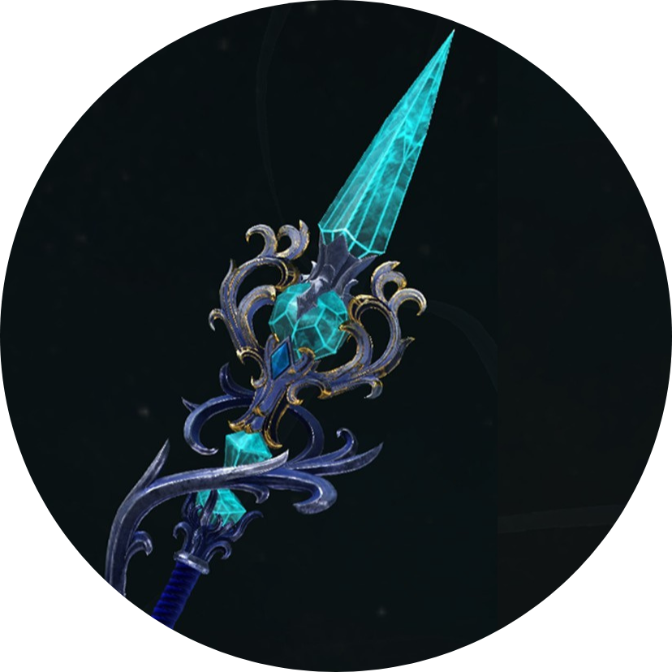
Spawns at the beginning of the first split phase (70%). Can use the skills: [Cosmic Charge], [Thousand Strikes].

#### Aspect of the Sword
{: .no_toc}
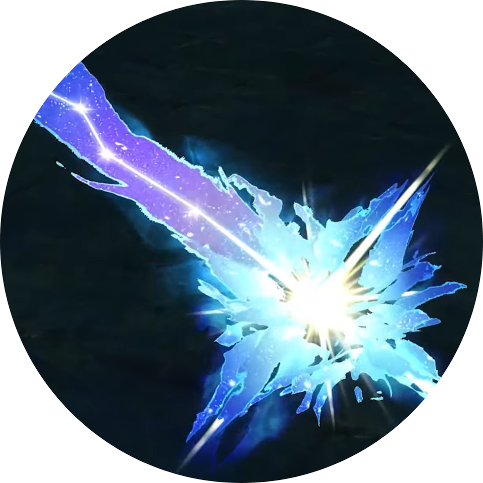
Spawns at the beginning of the second split phase (40%). Can use the skills: [Division Eternal], [Excision Extremis].

#### Champion Weapon
{: .no_toc .center}

| **Health** |  4,620,570  |
| **Defiance Bar** | 1000 |
| **Armor** | 2597 (standard) |
| **Hitbox** | 100 (small) |

Champion weapons spawn in before the main phase associated with their form. When killed, they will respawn 40 seconds later. They will always spawn and respawn at the same locations in the arena.

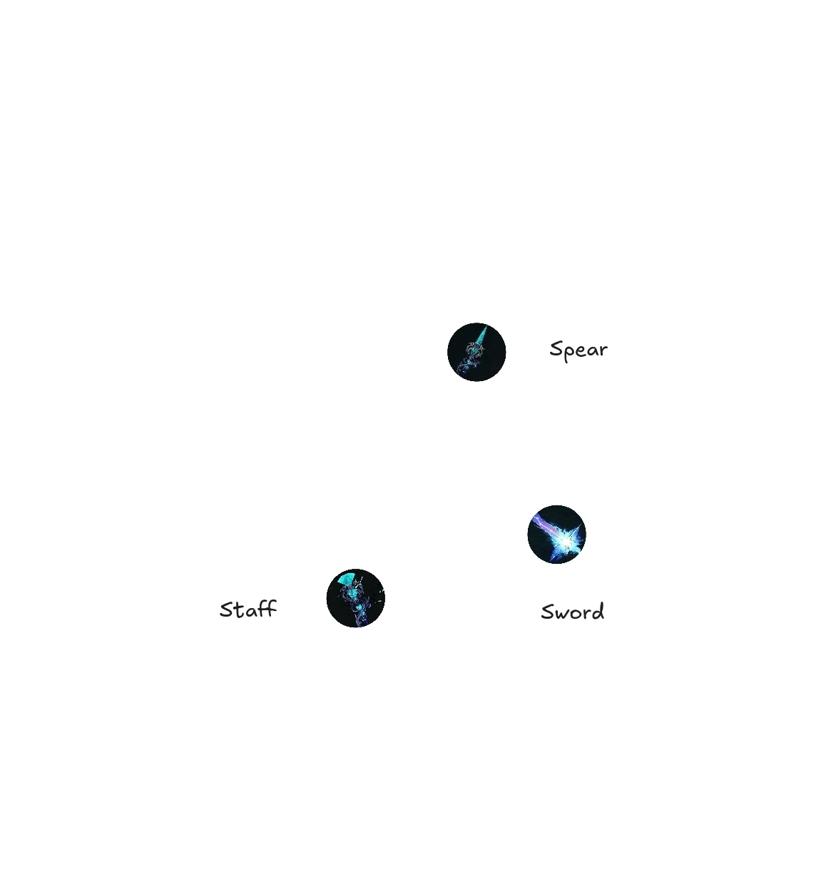

Weapon behaviour mainly consists in attempting to get in range of a player, then casting one of their available skills. Both the *Spear* and *Sword* are melee, and will attempt to get into melee range to attack. The *Staff* instead is ranged, and will stop at around 300 units from its target. Weapons will remain active as long as they are alive, continuously harassing the group through the entirety of the split phases and transitions up until the fight end.

Weapons will grant Vloxx a stack of  [Empowered] 24 seconds after spawning, and at 20 second intervals following.

{: .note}
This means that weapons should be killed at most 84 seconds after spawning to remain neutral on  [Empowered]. The  [True Visionary](https://wiki.guildwars2.com/wiki/The_Nexus_of_Eternity) achievement, which involves ending on less than 10 stacks, requires killing seven champions in less than 24 seconds, or 11 champions in less than 44 seconds, or 21 champions in less than 64 seconds.

Weapons gain a CC bar at 25% HP. When this bar is broken, they will spawn in three orbs that grant a stack of  [Ascension] when picked up by a player, removing a stack of  [Empowered] from Vloxx. These orbs can only be spawned once per add, and persist for 2 minutes before de-spawning.

---

### Elementals

There are three elemental types: the *Cosmic Piercer*, the *Cosmic Bulwark* and the *Cosmic Sunderer*.

#### Cosmic Piercer
{: .no_toc}
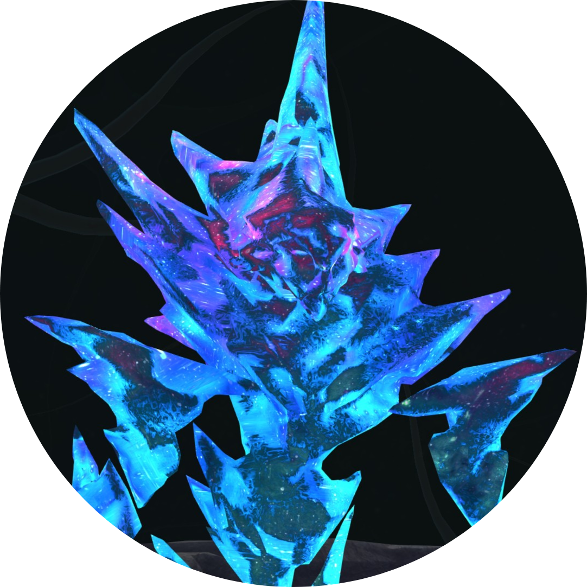
Spawns during the 70% split phase. Summons projectile waves and teleports.

#### Cosmic Bulwark
{: .no_toc}
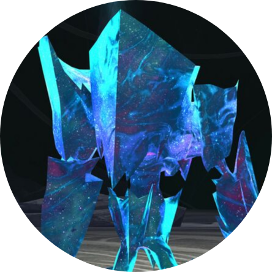
Spawns during the 40% split phase. Charges and knocks down enemies.

#### Cosmic Sunderer
{: .no_toc}
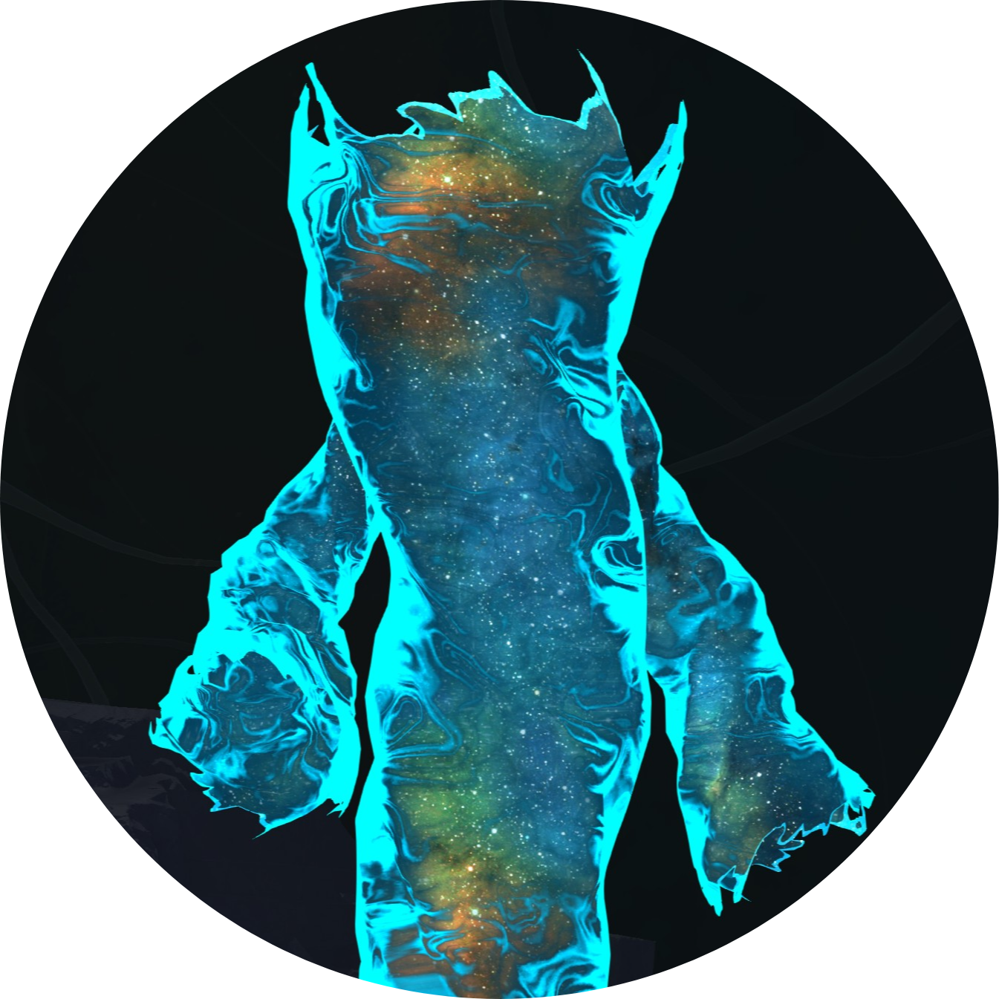
Spawns during the 10% split phase. He looks cool for a bit, I guess.

#### Champion Elemental
{: .no_toc .center}

| **Health** |  1,592,622  |
| **Defiance Bar** | 1000 |
| **Armor** | 2597 (standard) |
| **Hitbox** | 100 (small) |

A champion and three Elite versions of these enemies are spawned at the beginning of each split phase as a part of the cast of [Visions of Eternity]. Killing these adds is necessary to unlock Vloxx's  [Defiance Bar] and progress the encounter.

[Return to Home](../index.html){: .btn} [Strategy Guide](../strategy/index.html){: .btn} [Return to Top](#vloxx-mechanical-reference){: .btn .fixed}

<!-- Links to other pages in the guide -->
[Judgement of Eternity]: #judgement-of-eternity
[Probability Distribution]: #probability-distribution
[Visions of Eternity]: #visions-of-eternity
[Threshold of Eternity]: #threshold-of-eternity
[Annihilating Orb]: #annihilating-orb
[Ascension's Sacrifice]: #ascensions-sacrifice
[Eternal Reflection]: #eternal-reflection
[Surrounding Curse]: #surrounding-curse
[Cosmic Charge]: #cosmic-charge
[Raging Storm]: #raging-storm
[Thousand Strikes]: #thousand-strikes
[Worldpiercer]: #worldpiercer
[Division Eternal]: #division-eternal
[Echoing Blade]: #echoing-blade
[Excision Extremis]: #excision-extremis
[Slice Through Reality]: #slice-through-reality

[Ascension]: #-ascension
[Empowered]: #-empowered
[Fixate]: #-fixate
[Fixated]: #-fixate

[Phase 1]: #100---70---staff-phase
[Phase 2]: #70---40---spear-phase
[Phase 3]: #40---10---sword-phase
[Phase 4]: #10---0---perfect-form

<!-- Links to classes and specializations -->

<!-- Links to player skills -->
[Feedback]: https://wiki.guildwars2.com/wiki/Feedback
[Corrosive Poison Cloud]: https://wiki.guildwars2.com/wiki/Corrosive_Poison_Cloud
[We Will Never Yield!]: https://wiki.guildwars2.com/wiki/%22We_Will_Never_Yield!%22
[Tale of the August Queen]: https://wiki.guildwars2.com/wiki/Tale_of_the_August_Queen

<!-- Links to buffs and debuffs -->
[Downstating]: https://wiki.guildwars2.com/wiki/Downstate
[Invulnerable]: https://wiki.guildwars2.com/wiki/Invulnerability
[Invulnerability]: https://wiki.guildwars2.com/wiki/Invulnerability
[Vulnerability]: https://wiki.guildwars2.com/wiki/Vulnerability
[Might]: https://wiki.guildwars2.com/wiki/Might
[Resolution]: https://wiki.guildwars2.com/wiki/Resolution
[Protection]: https://wiki.guildwars2.com/wiki/Protection
[Stability]: ttps://wiki.guildwars2.com/wiki/Stability
[Float]: https://wiki.guildwars2.com/wiki/Float
[Floats]: https://wiki.guildwars2.com/wiki/Float
[Downstate]: https://wiki.guildwars2.com/wiki/Downstate
[Crippled]: https://wiki.guildwars2.com/wiki/Cripple
[Knockback]: https://wiki.guildwars2.com/wiki/Knockback
[Knockdown]: https://wiki.guildwars2.com/wiki/Knockdown
[Slow]: https://wiki.guildwars2.com/wiki/Slow
[Burning]: https://wiki.guildwars2.com/wiki/Burning
[Poison]: https://wiki.guildwars2.com/wiki/Poison
[Chilled]: https://wiki.guildwars2.com/wiki/Chilled
[Torment]: https://wiki.guildwars2.com/wiki/Torment
[Weakness]: https://wiki.guildwars2.com/wiki/Weakness
[Blinded]: https://wiki.guildwars2.com/wiki/Blinded
[Confusion]: https://wiki.guildwars2.com/wiki/Confusion
[Bleeding]: https://wiki.guildwars2.com/wiki/Bleeding
[Superspeed]: https://wiki.guildwars2.com/wiki/Superspeed
[Aegis]: https://wiki.guildwars2.com/wiki/Aegis

<!-- Links to enemies and enemy skills -->
[Champion Staff]: #weapons
[Champion Spear]: #weapons
[Champion Sword]: #weapons
[Champion Elemental]: #elementals
[Elite Elementals]: #elementals

<!-- Other -->
[Defiance Bar]: https://wiki.guildwars2.com/wiki/Defiance_bar
[Stunbreak]: https://wiki.guildwars2.com/wiki/Stun_break