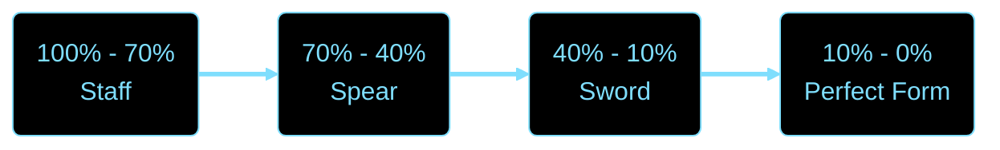
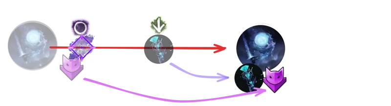
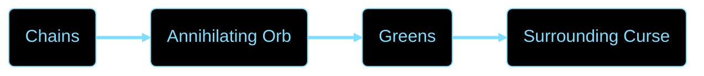

[Return to Home](../index.html){: .btn} [Mechanical Reference](../mechanics/index.html){: .btn}

# Strategy Guide
{: .no_toc}

<details>
<summary><b>Table of Contents</b></summary>
<div markdown=block>
1. TOC
{:toc}
</div>
</details>

The standard strategy for the Nexus of Eternity focuses on precise positioning and well-timed defensive utility. This guide is a written version of this  [video guide](https://www.youtube.com/watch?v=NNYx8mR8HwI) by *Wolf*.

---

#### Main Points
{: .no_toc}
- A large amount of defensive utility is required to manage Vloxx's attack variety. Projectile management and  [Stability] are common failure points.
- Vloxx deals a great amount of damage, which increases as the fight goes on. Proper healing and defensive capabilities are essential.
- Groups must constantly cleave [Champion Weapons] to counteract Vloxx's passive  [Empowered] gain.
- Vloxx randomly selects a  [Fixate] to focus with mechanics. This forces groups to adapt based on the target, especially for [solving greens](#solving-greens) and [opposition tanking]().


## General Information

Vloxx as an enemy has a large selection of attacks. However, he only has access to a subset of these at any time depending on his equipped weapon, which in turn depends on the phase of the encounter.


{: .center}
As a result, all four phases feature different mechanics and thus play quite differently:

- The [Staff Phase] concentrates on positioning to facilitate cleaving the [Champion Staff].
- The [Spear Phase] has a large focus on projectile disruption and the overlap between [Worldpiercer] and [Cosmic Charge] with [Greens].
- The [Sword Phase] emphasizes  [Fixate] positioning to manage the huge incoming damage from [Excision Extremis].
- The [Final Phase] combines attacks from all previous phases, and is played differently depending on whether the encounter is in Challenge or Legendary mode.

---

###  Empowered and Weapon Management

Vloxx, similarly to other bosses such as [Cerus](https://silverhalf.github.io/temple-of-febe/) and [Greer](https://silverhalf.github.io/mount-balrior/greer/overview.html), will *actively* gain  [Empowered] stacks whenever players fail mechanics. However, unlike these other encounters, Vloxx also has several sources of *passive* gain. Left alone, the boss will gradually accumulate  [Empowered] until the squad wipes, due to either damage or enrage.

As a result, it is not sufficient to play the encounter without failing mechanics: groups are forced to actively reduce the number of  stacks on the boss by engaging with the  [Ascension] mechanic. This results in significant strategic considerations in order to efficiently aggro any [Champion Weapons] to the boss, cleave them down and CC them.

When done correctly, this results in weapons granting fewer  [Empowered] and provides a steady source of  [Ascension] to offset any other gains.

---

### Solving Greens

[Judgement of Eternity], mostly known as [Greens], is one of the encounter's more challenging mechanics. This attack is present in all four phases, and requires careful attention and some improvisation to solve reliably.

Since greens are only assigned to the  [Fixate] and closest players, two common strategies exist for this mechanic:
- [Anchor Greens](../mechanics/index.html#strategy-anchors) assigns two players, called *anchors*, to bait the mechanic.
- [Subgroup Greens](../mechanics/index.html#strategy-subgroups) has four people (an entire subgroup minus the healer) bait the mechanic.

{: .note}
Click on the links above to view in-depth descriptions for both strategies.

<div class="alt-row-container">
<div class="strategy bordered" markdown=block>
#### [Anchor Baiting](../mechanics/index.html#strategy-anchors)
{: .no_toc .center}

 Almost exclusive to the EU region. <br>
 Greens know where to go in advance.<br>
 Chaotic if not baited correctly. 
</div>
<div class="strategy bordered" markdown=block>
#### [Subgroup Baiting](../mechanics/index.html#strategy-subgroups)
{: .no_toc .center}

 Almost exclusive to the NA region. <br>
 Requires a green to move after baiting. <br>
 More reliable baiting of greens.

</div>
</div>

Groups should decide on the strategy beforehand, and assign players to their specific roles.
- For [Anchor Greens](../mechanics/index.html#strategy-anchors), choose the three *anchors* and the *float*. Assign two additional players to each anchor, so that three are in each group.
- For [Subgroup Greens](../mechanics/index.html#strategy-subgroups), choose which subgroup is *melee* and which is *ranged*. Choose one non-heal player from the *ranged* subgroup to be the *float*.

---

### Projectile Management

Vloxx has a love-hate relationship with projectile management.

In the first phase, reflection or nullification skills can be extremely dangerous due to [Eternal Reflection]. This skill will generate large amounts of AoE damage when hitting these effects, easily leading to  [Downstates]. Groups will generally avoid using any projectile nullification except when they are absolutely certain that it will not overlap with this mechanic.

In phase 2, [Raging Storm] requires at least 20 seconds of continuous coverage to prevent both the  [Knockback] and the formation of dangerous pools under the group. This is usually done either by running a *solo bubble*, such as a heal  [Vindicator], or by setting up a *rotation* with at least four sources of projectile negation, usually either  [Feedback] or  [Corrosive Poison Cloud].

In the final phase, [Raging Storm] lasts for the entire phase. This requires permanent projectile reflection (outside of legendary mode), which can again be done with a solo bubble. Alternatively, have three  [Necromancers] rotate casts of  [Corrosive Poison Cloud]. With the proper timing, this skill can be re-cast off cooldown to provide permanent coverage for the main stack, freeing up  [Feedback] for the side groups during greens.

---

### Markers

Markers are commonly used in order to highlight specific positions in the arena:

-  is used to show the [Champion Staff]'s spawn position.
-  highlights the position the  [Fixate] has to stack on at the beginning of the [Spear Phase].
-  is used to highlight the stacking position for the final phase.
-  and  are purposely not used, as these markers are often given to the *anchors*.

This guide will use these positions as a reference for the strategy.

<details>
<summary>Download Markers</summary>
<div markdown=block>
The following code can be pasted into the [Commander Markers](https://blishhud.com/modules/?module=Manlaan.CommanderMarkers) module for [Blish HUD](https://blishhud.com).
```
eyJlbmFibGVkIjp0cnVlLCJuYW1lIjoiTWFya2VycyIsImRlc2NyaXB0aW9uIjoiZGVzY3JpcHRpb24iLCJtYXBJZCI6MTYzOCwidHJpZ2dlciI6eyJ4IjowLjAsInkiOjAuMCwieiI6MC4wfSwibWFya2VycyI6W3siaSI6MiwiZCI6Im1hcmtlciBuYW1lIiwieCI6MzA3LjU2ODEsInkiOjM5NS40NzcwODEsInoiOjMxNC44ODA0NjN9LHsiaSI6MSwiZCI6bnVsbCwieCI6MzAxLjA3MTc3NywieSI6NDA4LjYxNiwieiI6MzE0LjgzNzM3Mn0seyJpIjo2LCJkIjpudWxsLCJ4IjozMDcuNTY4MSwieSI6Mzk1LjQ3NzA4MSwieiI6MzE0Ljg4MDQ2M30seyJpIjo1LCJkIjpudWxsLCJ4IjozMDcuNTU3NjQ4LCJ5IjozOTUuNzE3MywieiI6MzE0Ljg1NTEzM30seyJpIjo3LCJkIjpudWxsLCJ4IjozMDIuMDE2NTcxLCJ5IjozODguODAxMDU2LCJ6IjozMTQuODM3NDMzfSx7ImkiOjMsImQiOm51bGwsIngiOjIxNy4yMzY0NSwieSI6NDAxLjA5NDIsInoiOjMxNC4xNDcyNDd9LHsiaSI6NCwiZCI6bnVsbCwieCI6MjE4LjA5MDI0LCJ5IjozOTEuMTM2NywieiI6MzE0LjI1NX0seyJpIjo4LCJkIjpudWxsLCJ4IjoyMDguMTg1MDg5LCJ5IjozOTUuNDU1MzIyLCJ6IjozMTQuMDQ5MTY0fV19
```

Alternatively, you can download a marker pack for [TaimiHUD](https://taimihud.com/) [here](./vloxx.markers). Place it in the `.../Guild Wars 2/addons/Taimi/markers` folder to see it in-game.
</div>
</details>


## Composition

Groups attempting to clear the Nexus of Eternity will benefit from a large amount of defensive utility, including:

- *Projectile Negation*: permanent coverage for CM, or at least 20 seconds of continuous duration for LCM.
-  [Stability]: multiple stacks on a medium cooldown.
- Group  [Stunbreak]: on a medium-long cooldown.
-  [Superspeed]: very useful since the encounter has a lot of movement.
- *Cleave*: to manage [Champion Weapons] and split phases efficiently.
- *Crowd Control*: necessary for [Champion Weapons], [Champion Elementals] and for Vloxx's large  [Defiance Bar] after every split phase.
- High *Survivability* and *Healing*: the boss will start dealing obscene damage towards the end of the fight due to  [Empowered].
- *Condition Cleanse*: most of Vloxx's attacks apply some form of damaging or debilitating condition.

By looking at this daunting list of requirements, one can understand why  [Troubadour] is the ubiquitous healer on this encounter. Its strong healing output, large boon radius and incredible defensive utility with skills such as  [Tale of the Honorable Rogue],  [Tale of the Valiant Marshal] and  [Tale of the August Queen] make it stand head and shoulders above any other defensive support. It can also run with a [Celestial] build to improve damage output at the cost of some healing power.

As a result of  [Troubadour]'s dominance, boon supports will almost always bring  [Alacrity]. Common picks include  [Evoker],  [Luminary] and  [Amalgam].  [Specter] is also a viable pick as it provides large amounts of CC when running spear, but is not as common due to its significant damage handicap compared to its alternatives.

Common strategies cover projectile negation by running at least three  [Scourges] with  [Corrosive Poison Cloud] (two in Legendary Mode). These also bring additional utility for the encounter, such as  [Epidemic] and large amounts of condition cleanse. Alternatively, some groups will run a heal  [Vindicator] to cover projectile negation on its own, pairing it with a [Celestial]  [Troubadour].

The encounter generally favours *condition damage*, since phases are long and conditions will keep ticking on the boss for some time after the beginning of each split phase. Condition builds also have the advantage of [Trailblazer] prefix gear, granting them massively improved survivability for a moderate DPS loss.


## First Phase

In this phase, Vloxx will wield his staff and have access to [staff skills](../mechanics/index.html#staff-attacks). These feature a large amount of projectiles, which should be dodged or healed, but ideally not reflected due to the risk of interacting with [Eternal Reflection].

{: .note}
The mechanic order described in this phase is the standard that most players will see in most pulls. However, Vloxx can self-interrupt if he's forced to move, resulting in a new order. This can be avoided by maintaining constant  [Immobile] uptime.

#### Before the Fight

- Place down [markers].
- Decide on a [green strategy](#solving-greens). Divide the squad into groups based on the strategy.
- Set up a [rotation](#projectile-management) for projectile management in phase 2 and phase 4.

---

#### Opening Sequence


{: .note}
Not pictured in the diagram above are various casts of [Eternal Reflection], which are common enough that representing them would be counterproductive.

Begin the fight by having one person walk into the arena and then immediately exit. They will gain the initial  [Fixate], and the whole squad will be teleported to the middle of the arena without having to walk in. This also ensures that only the  [Fixate] will get a [green], since everyone else will be out of range.

After the green pops, the  [Fixate] should stand on  to bait [Annihilating Orb] towards the [Champion Staff] on . Healers should provide  [Stability] for this mechanic using  [Tale of the Valiant Marshal] as it will be off-cooldown when required.  [Tale of the August Queen] should also be used to protect players from the boonstrip under the orb.

Provide  [Superspeed] to get to the boss while jumping or dodging the shockwave from [Annihilating Orb]. Stand to the side of his hitbox in order to bait the [Champion Staff] closer and start cleaving it down. Do not stand between the boss and the arena wall: this can cause the staff to overlap completely with Vloxx's hitbox, which will cause him to walk away until they no longer overlap.



{: .warning}
The [Champion Staff] is affected by movement-impairing conditions such as  [Immobile] and  [Chilled]. For this reason, groups should try to avoid applying conditions to it, including using skills such as  [Epidemic], until it can be cleaved.

Healers can immediately target the staff once it's close, so they are ready to CC it when it reaches 25% HP. Have players walk away from it beforehand so that they do not prematurely pick up any  [Ascension].

{: .warning}
Only collect orbs if there are more than one stack of  [Empowered] on the boss. This is because orbs will only be generated when CCing a weapon if Vloxx has at least one  stack.

Players targeted by [Probability Distribution] (including the  [Fixate]) can place it down between the boss and the arena, leaving some free space closer to the boss if possible. The  [Fixate] should then stand opposite from the rest of the group, baiting [Eternal Reflection] away from them.

---

#### Second Sequence



The  [Fixate] should move on group before [chains] start spawning. As soon as the third green appears, the healers will  [Stunbreak] using  [Tale of the Valiant Marshal]. Players should pay attention so that greens do not overlap and at least two people are present in each green.

Immediately after the  [Stunbreak], the  [Fixate] should position between Vloxx and the arena wall to bait [Annihilating Orb]. When done correctly, this ensures that the ensuing dash is interrupted by the arena wall, resulting in minimal movement by the boss and increased damage uptime. Healers should provide  [Stability] for the dash and shockwave using  [Crescendo].

After the dash, players should be ready to bait [Greens]. This is the first time in the encounter that they will actually need to be solved, but this should be easy since the  [Fixate] should still be the person that started the fight, as less than a minute will have passed.

---

#### Third Sequence


Place the [pools] from [Probability Distribution] away from the group, towards the wall. This mechanic usually coincides with a new  [Fixate], who should then position between the boss and  to bait the dash towards the [Champion Staff], as it will be respawning soon.

[Chains] and [Greens] are then solved the same as previously. Groups with high DPS should be phasing during this sequence.

---

#### Final Sequence


If you get an additional dash, try to bait it again towards . The remaining mechanics are not threatening and should be played normally. Groups should not phase much after the final [Probability Distribution], otherwise they will struggle to remain within the enrage timer.


## Second Phase

In very high DPS groups that rapidly complete the split phase, [Judgement of Eternity] will not have come off cooldown before the beginning of the second phase. This will mix up the precise order of mechanics, resulting in the boss dashing first before casting [Judgement of Eternity]. Most considerations in this section remain valid, but players will have to adapt to the new order.

#### First Split Phase

After phasing the boss to 70%


## Third Phase


## Final Phase


[Return to Home](../index.html){: .btn} [Mechanical Reference](../mechanics/index.html){: .btn} [Return to Top](#strategy-guide){: .btn .fixed}

<!-- Links to other pages in the guide -->
[Judgement of Eternity]: ../mechanics/index.html#judgement-of-eternity
[Greens]: ../mechanics/index.html#judgement-of-eternity
[green]: ../mechanics/index.html#judgement-of-eternity
[Probability Distribution]: ../mechanics/index.html#probability-distribution
[pools]: ../mechanics/index.html#probability-distribution
[Visions of Eternity]: ../mechanics/index.html#visions-of-eternity
[Threshold of Eternity]: ../mechanics/index.html#threshold-of-eternity
[Annihilating Orb]: ../mechanics/index.html#annihilating-orb
[Ascension's Sacrifice]: ../mechanics/index.html#ascensions-sacrifice
[chains]: ../mechanics/index.html#ascensions-sacrifice
[Eternal Reflection]: ../mechanics/index.html#eternal-reflection
[Surrounding Curse]: ../mechanics/index.html#surrounding-curse
[Cosmic Charge]: ../mechanics/index.html#cosmic-charge
[Raging Storm]: ../mechanics/index.html#raging-storm
[Thousand Strikes]: ../mechanics/index.html#thousand-strikes
[Worldpiercer]: ../mechanics/index.html#worldpiercer
[Division Eternal]: ../mechanics/index.html#division-eternal
[Echoing Blade]: ../mechanics/index.html#echoing-blade
[Excision Extremis]: ../mechanics/index.html#excision-extremis
[Slice Through Reality]: ../mechanics/index.html#slice-through-reality

[Ascension]: ../mechanics/index.html#-ascension
[Empowered]: ../mechanics/index.html#-empowered
[Fixate]: ../mechanics/index.html#-fixate
[Fixated]: ../mechanics/index.html#-fixate

[Phase 1]: #first-phase
[Staff Phase]: #first-phase
[Phase 2]: #second-phase
[Spear Phase]: #second-phase
[Phase 3]: #third-phase
[Sword Phase]: #third-phase
[Phase 4]: #final-phase
[Final Phase]: #final-phase

[markers]: #markers

<!-- Links to classes and specializations -->
[Vindicator]: https://wiki.guildwars2.com/wiki/Vindicator
[Necromancers]: https://wiki.guildwars2.com/wiki/Necromancer
[Troubadour]: https://wiki.guildwars2.com/wiki/Troubadour
[Evoker]: https://wiki.guildwars2.com/wiki/Evoker
[Luminary]: https://wiki.guildwars2.com/wiki/Luminary
[Amalgam]: https://wiki.guildwars2.com/wiki/Amalgam
[Specter]: https://wiki.guildwars2.com/wiki/Specter
[Scourge]: https://wiki.guildwars2.com/wiki/Scourge
[Scourges]: https://wiki.guildwars2.com/wiki/Scourge

<!-- Links to player skills -->
[Feedback]: https://wiki.guildwars2.com/wiki/Feedback
[Corrosive Poison Cloud]: https://wiki.guildwars2.com/wiki/Corrosive_Poison_Cloud
[We Will Never Yield!]: https://wiki.guildwars2.com/wiki/%22We_Will_Never_Yield!%22
[Tale of the Honorable Rogue]: https://wiki.guildwars2.com/wiki/Tale_of_the_Honorable_Rogue
[Tale of the Valiant Marshal]: https://wiki.guildwars2.com/wiki/Tale_of_the_Valiant_Marshal
[Tale of the August Queen]: https://wiki.guildwars2.com/wiki/Tale_of_the_August_Queen
[Epidemic]: https://wiki.guildwars2.com/wiki/Epidemic
[Crescendo]: https://wiki.guildwars2.com/wiki/Crescendo

<!-- Links to buffs and debuffs -->
[Downstating]: https://wiki.guildwars2.com/wiki/Downstate
[Downstates]: https://wiki.guildwars2.com/wiki/Downstate
[Invulnerable]: https://wiki.guildwars2.com/wiki/Invulnerability
[Invulnerability]: https://wiki.guildwars2.com/wiki/Invulnerability
[Vulnerability]: https://wiki.guildwars2.com/wiki/Vulnerability
[Might]: https://wiki.guildwars2.com/wiki/Might
[Resolution]: https://wiki.guildwars2.com/wiki/Resolution
[Protection]: https://wiki.guildwars2.com/wiki/Protection
[Stability]: ttps://wiki.guildwars2.com/wiki/Stability
[Float]: https://wiki.guildwars2.com/wiki/Float
[Floats]: https://wiki.guildwars2.com/wiki/Float
[Downstate]: https://wiki.guildwars2.com/wiki/Downstate
[Crippled]: https://wiki.guildwars2.com/wiki/Cripple
[Knockback]: https://wiki.guildwars2.com/wiki/Knockback
[Knockdown]: https://wiki.guildwars2.com/wiki/Knockdown
[Slow]: https://wiki.guildwars2.com/wiki/Slow
[Burning]: https://wiki.guildwars2.com/wiki/Burning
[Poison]: https://wiki.guildwars2.com/wiki/Poison
[Chilled]: https://wiki.guildwars2.com/wiki/Chilled
[Torment]: https://wiki.guildwars2.com/wiki/Torment
[Weakness]: https://wiki.guildwars2.com/wiki/Weakness
[Blinded]: https://wiki.guildwars2.com/wiki/Blinded
[Confusion]: https://wiki.guildwars2.com/wiki/Confusion
[Bleeding]: https://wiki.guildwars2.com/wiki/Bleeding
[Superspeed]: https://wiki.guildwars2.com/wiki/Superspeed
[Aegis]: https://wiki.guildwars2.com/wiki/Aegis
[Alacrity]: https://wiki.guildwars2.com/wiki/Alacrity
[Immobile]: https://wiki.guildwars2.com/wiki/Immobile

<!-- Links to enemies and enemy skills -->
[Champion Staff]: ../mechanics/index.html#weapons
[Champion Spear]: ../mechanics/index.html#weapons
[Champion Sword]: ../mechanics/index.html#weapons
[Champion Weapons]: ../mechanics/index.html#weapons
[Champion Elemental]: ../mechanics/index.html#elementals
[Champion Elementals]: ../mechanics/index.html#elementals
[Elite Elementals]: ../mechanics/index.html#elementals

<!-- Other -->
[Defiance Bar]: https://wiki.guildwars2.com/wiki/Defiance_bar
[Stunbreak]: https://wiki.guildwars2.com/wiki/Stun_break
[Trailblazer]: https://wiki.guildwars2.com/wiki/Trailblazer's
[Celestial]: https://wiki.guildwars2.com/wiki/Celestial